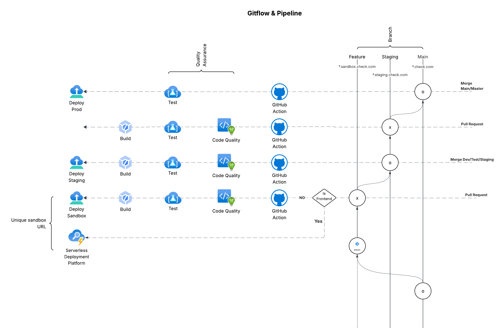

# Gitflow & CI/CD Workflow

This document outlines the branching strategy and CI/CD pipeline for engineering projects.

## Gitflow Diagram

---

## 📌 Source of Truth
- **Staging** branch is the single source of truth.
- **Master/Prod** only accepts merge requests from **Staging**.

---

## 🔀 Branching Strategy
- Developers create branches using the following conventions:
  - `feat/*` or `feature/*` for new features
  - `bug/*` for bug fixes

---

## ⚙️ Feature & Bug Branch Workflow
- On **commit push** to a `feat/*` or `feature/*` or `bug/*` branch:
  - Linting
  - Code quality analysis
  - Feature tests
  - Unit tests
  - Build
- Successful builds are deployed to a **unique sandbox URL**:
  - Example:  
    `https://adidas-user-auth.feature.check-dc.com` for `feat/user-auth`

---

## 🚧 Staging Workflow
- CI/CD runs **only on pull requests** to `staging` (not on direct commits).
- Pipeline executes:
  - Build
  - Test
  - Code quality checks
- Deployment goes to the **shared staging environment**:
  - Example:  
    `https://adidas.staging.check-dc.com`

---

## 🚀 Production Workflow
- Pull requests to `master/prod` require approval from:
  - Team Lead
  - QA
- CI runs automatically on PR.
- CD (deployment to production) is **manual**, triggered via GitHub Actions.

---

## ✅ Benefits
- Controlled flow: only staging can merge into master.
- Automated quality gates: every commit and PR validated before deployment.
- Isolated testing: unique sandbox URLs for feature validation.
- Governance: manual approval + manual prod deploy ensures accountability.
